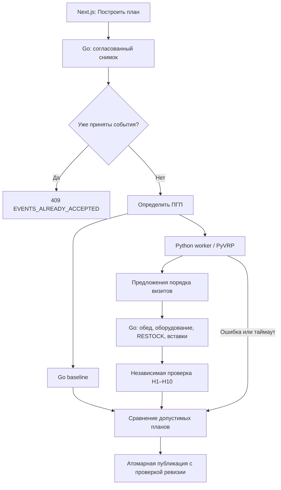

# PyVRP в МаксТелеком

Реализовано 14 ноября 2026 года, API 0.7.0. Бесплатный PyVRP 0.14.0 подключён к первоначальному планированию через внутренний Python-сервис. Он предлагает назначения и порядок визитов; Go восстанавливает точное расписание, проверяет ограничения и сравнивает результат с базовым алгоритмом. Платные Enterprise-функции не используются. AI-помощник отменён решением команды.

## Измеренный результат

Собственный синтетический набор: 40 сотрудников, 5 СЦ, 400 заявок, направленная матрица OSRM. Бюджет поиска — 30 секунд, seed решателя — 0. Baseline и поиск кандидатов работают параллельно в рамках одного бюджета.

| Метрика                          | Go baseline | PyVRP + Go |
| -------------------------------- | ----------: | ---------: |
| Назначенные визиты               |         207 |        231 |
| Взвешенные визиты, повторный = 2 |         221 |        245 |
| Время переездов, секунды         |      145575 |     105998 |
| Нераспределённые                 |         190 |        166 |
| Обращения ПГП                    |           3 |          3 |
| CV загрузки, меньше лучше        |       0,324 |      0,359 |

В этом прогоне назначено на 11,6% больше визитов, переезды короче на 27,2%. Выполнение CLI с восстановлением и проверкой заняло 20,119 секунды. Равномерность загрузки ухудшилась: она имеет меньший приоритет, чем покрытие и дорога.

Отдельно проверен реальный запрос Next.js proxy → Go → Python → PostgreSQL: 230 визитов вместо 207, 167 Unassigned, 3 ПГП, 111523 секунды дороги; ответ за 19,155 секунды. Для этого добавлен учебный день **2026-10-29** со сдвигом исходного набора на сутки. День 2026-10-28 с принятыми событиями сохранён.

Это одиночные замеры на учебных данных, а не гарантия для скрытого набора или p95. MaxRuntime зависит от скорости машины: одинаковый seed не гарантирует идентичный план. SHA-256 входных файлов и метрики: [benchmarks/pyvrp-40-400.json](benchmarks/pyvrp-40-400.json). Полные локальные планы: `work/pyvrp-benchmark.json`, `work/pyvrp-api-demo.json`.

## Архитектура



Go владеет БД, модельным временем, ПГП, предупреждениями и историей. Worker не имеет доступа к PostgreSQL. Контракт организаторов не изменён; дополнительное поле ответа `optimization` разрешено его правилами.

## Модель и проверка

- Сотрудник представлен машиной с домашним СЦ, сменой и тремя измерениями вместимости оборудования. Наряд имеет отдельную модельную локацию, норматив, окно начала и deadline. Два наряда в одном здании не сливаются.
- Используется направленная матрица текущего снимка Go. Переезды по прямой и запросы к картам при поиске отсутствуют. `hourly_factors` по действующим правилам планировщика не применяются.
- Допуски профиля, технологии, высоты и вместимости задаются routing profiles. Переезд к недопустимой работе получает 86400 секунд, что превышает любую смену данного однодневного кейса. Go дополнительно проверяет каждое назначение.
- PyVRP строит два предложения: целая смена без точного обеда и два сегмента с фиксированным промежутком обеда. Второй вариант консервативно возвращает каждый сегмент в домашний СЦ. Это предложения последовательностей, а не окончательные расписания.
- Go перебирает положение настоящего обеда, учитывает `equipment_start`, вставляет RESTOCK в открытых СЦ, возвращение домой и оставшиеся заявки. Не поместившийся визит снова пробуется через вставку или учитывается в Unassigned.
- `initial_load` PyVRP имеет другую семантику и не используется как остаток рюкзака. Начальный запас и пополнение проверяет Go. Бесплатная библиотека сама по себе не реализует все требования кейса.

В PyVRP используются ограниченные призы за назначение и повышенный вес повторного обращения. После восстановления Go сравнивает планы строго по порядку:

1. Больше взвешенных визитов, повторный = 2.
2. Больше обычных визитов при равенстве первого показателя.
3. Меньше времени переездов по исходной матрице.
4. Меньше CV загрузки при равенстве предыдущих показателей.

Равный или худший кандидат не заменяет baseline. Оптимальность не доказана. Неудача поиска не доказывает невозможность назначения всех оставшихся работ.

## Бюджеты и резервный расчёт

API принимает прежний `time_limit_sec` 1–300. При менее пяти секундах доступного поиска используется быстрый Go-режим. Обычно 60% оставшегося времени выделяется worker, не более 180 секунд; остальное — точному восстановлению. Baseline работает параллельно с тем же общим deadline. Сохраняется резерв на проверку и фиксацию БД.

MaxRuntime не включает всю подготовку модели, поэтому запрос запускается в отдельном subprocess с внешним пределом `budget + 0,75 с`. Просроченный процесс уничтожается. Один worker выполняет один поиск; конкурентный запрос получает 503 без очереди, а Go сохраняет baseline. Worker ограничен 1 ГиБ RAM, 600 заявками и 100 сотрудниками; его порт не публикуется на хост.

Недоступность, занятость, таймаут, повреждённый ответ, недопустимое назначение и отсутствие улучшения оставляют допустимый базовый план. Изменившиеся во время расчёта данные по-прежнему запрещают публикацию устаревшего результата.

Снимок БД и ответ содержат `optimization`: engine, status, версия, seed, baseline/candidate/selected, модель, число проверенных кандидатов и время solver. Метрики пересчитывает Go. Диспетчерская показывает результат оптимизации или резервный режим.

## События

Все шесть событий продолжают обрабатываться Go: NEW_ORDER, ORDER_CANCELLED, VISIT_DELAYED, ORDER_TRANSFERRED, STAFF_UNAVAILABLE, TIME_TICK. Сохраняются дедупликация, замороженный префикс H10 и атомарность. PyVRP на событиях не вызывается. После первого события первоначальный расчёт запрещён контрактом.

В событийной версии поле `optimization` удаляется, чтобы не выдавать первоначальные метрики за новый поиск. Первоначальный снимок с отчётом остаётся в истории БД.

## Запуск

Из корня проекта при работающем Docker Desktop:

```powershell
docker compose --profile routing up -d --build --wait
Invoke-RestMethod http://127.0.0.1:8080/api/v1/health
```

Обычный запуск сохраняет данные. Первый учебный импорт — `npm run demo:load`. Повторный `--replace` явно сбрасывает только учебную БД; для запуска он не нужен.

Сравнить алгоритмы на файлах без обращения к БД:

```powershell
npm run optimizer:benchmark
# Другой бюджет:
docker compose --profile tools run --rm benchmark -budget 60s -output /app/work/pyvrp-60s.json
```

Отчёт по умолчанию: `work/pyvrp-benchmark.json`.

Для дня без принятых событий, после входа диспетчером (на публичном порту 8080 теперь действует авторизация):

```powershell
$account = Get-Content work/demo-accounts.json -Raw | ConvertFrom-Json | Where-Object username -eq 'dispatcher'
Invoke-RestMethod -Method Post -Uri http://127.0.0.1:8080/auth/v1/session `
  -ContentType 'application/json' -SessionVariable mtSession `
  -Body (@{username=$account.username; password=$account.password} | ConvertTo-Json) | Out-Null
$plan = Invoke-RestMethod -Method Post -WebSession $mtSession `
  -Uri http://127.0.0.1:8080/api/v1/days/2026-10-29/plan `
  -ContentType 'application/json' `
  -Body '{"time_limit_sec":30}'
$plan.optimization | ConvertTo-Json -Depth 5
```

`EVENTS_ALREADY_ACCEPTED` означает, что надо продолжать через события или использовать другой учебный день; это не неисправность PyVRP.

Проверки:

```powershell
npm run optimizer:test
docker compose --profile test run --build --rm tests
npm run check
```

Проверены настоящий PyVRP на малом наборе, допуски, недопустимая высотная работа, HTTP, занятость, уничтожение процесса при таймауте; в Go — улучшение, отклонение плохого кандидата, недоступный/повреждённый worker, короткий бюджет, обед, неполный запас, RESTOCK, H1–H10, сохранение отчёта в реальной PostgreSQL и изоляция событий. Прежние проверки событий, конкуренции и откатов сохранены.

`OPTIMIZER_URL=http://optimizer:8090` — внутренний адрес Compose. Для Go на хосте нужен доступный worker либо пустая настройка. `OPTIMIZER_URL=` в `.env` отключает интеграцию; после изменения пересоздайте API: `docker compose up -d --force-recreate api`. Worker не заменяет OSRM и не предоставляет пробки.

## Дальнейшая работа

Независимые дни/seed, повторные замеры и p95, улучшение равномерности. Подключение решателя к остаточной задаче событий требует отдельной проверки H10. Персональный вход, права и приём обращений реализованы; следующая бизнес-задача — преобразование обращения в согласованный наряд. См. [ACCESS_AND_WORKSPACE.md](ACCESS_AND_WORKSPACE.md).

## Первичные источники

- [PyVRP: возможности и Enterprise-ограничения](https://pyvrp.org/stable/).
- [Routing profiles](https://pyvrp.org/stable/notebooks/profiles.html).
- [API и семантика initial_load](https://pyvrp.org/stable/api/pyvrp.html).
- [Stopping criteria и MaxRuntime](https://pyvrp.org/stable/api/stop.html).
- [Исходный код, MIT, тесты и публикация](https://github.com/PyVRP/PyVRP).
